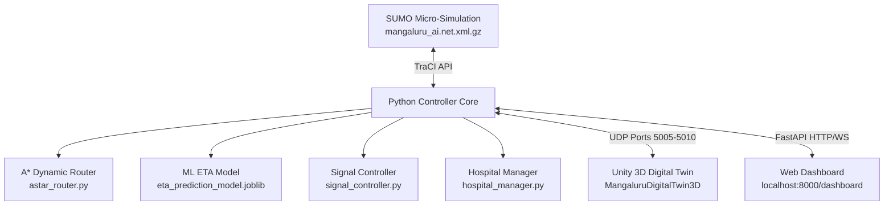

# Final Project Status: Mangaluru AI Digital Twin
**Project Title:** AI-Powered Predictive Routing and Signal Preemption in a Digital Twin Environment  
**Academic Degree:** Final-Year BE in Artificial Intelligence & Machine Learning (AIML)  
**Workspace:** `D:\AIML\Projects\Major\AI-Predictive-Traffic` (Python/SUMO) & `D:\AIML\Projects\Major\MangaluruDigitalTwin3D` (Unity)  
**Date:** October 2026  

---

> [!IMPORTANT]
> **Academic Prototype Disclaimer:**  
> This system is an academic research simulation prototype and digital twin testing environment developed using Eclipse SUMO and Unity 3D. It is **not** a field-validated emergency-response dispatch system and is intended exclusively for educational demonstration and simulation-based research.

---

## 1. Executive Summary & Objective

Urban emergency transit faces severe delays at signalized intersections and congested corridors. Conventional emergency vehicle transit relies on sirens, line-of-sight visual yielding, or localized optical emitters that trigger abrupt signal changes. This project designs, implements, and benchmarks a cyber-physical digital twin that combines:
1. **Digital Road Network Modeling:** A real-world representation of Mangaluru city (Kankanady, Balmatta, Falnir, Hampankatta corridors).
2. **Dynamic Traffic-Aware A* Routing:** Cost-optimized emergency pathfinding accounting for road capacity, congestion slowdown, and halted vehicle queues.
3. **Machine Learning ETA Prediction:** Multi-feature models predicting junction-by-junction travel times to enable predictive green-wave clearance.
4. **Predictive Signal Preemption:** Traffic light preemption that proactively clears downstream queues while safeguarding cross-traffic and restoring normal signal cycles.
5. **3D Digital Twin Visualization:** Unity 3D visualization synchronized in real time with SUMO micro-simulation via UDP telemetry, supported by an interactive web dashboard.

---

## 2. System Architecture

### Core Subsystems:
- **Simulation Layer (`simulation/mangaluru/`):**
  - Network: 1,764 edges, 825 nodes, 55 traffic-light-controlled junctions.
  - Configurations: `ambulance_test.sumocfg` and `presentation_demo.sumocfg`.
  - Landmarks: 11 real-world hospitals mapped with exact coordinates and nearest road ingress edges.
- **AI Decision & Control Layer (`controller/`):**
  - `astar_router.py`: Traffic-aware A* search with admissible Euclidean heuristic ($h(n) \le h^*(n)$) considering travel time, queued vehicle clearance penalty (2.5s/veh), and signal delays.
  - `hospital_manager.py`: Destination resolution for Athena, Highland, KMC, Father Muller, SCS, Unity, and City hospitals.
  - `signal_controller.py` & `signal_mapping.py`: Movement-to-TLS phase mappings with mandatory yellow transition (3.0s), hold times (8.0s), and automatic post-clearance restoration.
  - `models/eta_prediction_model.joblib`: Production Random Forest regressor inferring remaining travel time across 8 traffic and signal features.
- **Telemetry & Visualization Layer (`visualization/` & Unity):**
  - `visualization/unity_bridge.py`: Multi-threaded UDP bridge streaming vehicle transforms (5005), traffic positions (5006), signal states (5007), route paths (5008), and command feedback (5009).
  - `MangaluruDigitalTwin3D`: Unity URP project with procedural road rendering, vehicle smoothing, hospital billboard markers, and camera tracking.

---

## 3. Implementation Verification & Test Results

All primary components were verified using automated regression scripts without mock data:

| Component / Test | Verification Command | Exit Code | Verified Outcome |
| :--- | :--- | :---: | :--- |
| **System Baseline Suite** | `python scratch/final_completion/test_system_baseline.py` | `0` | 7/7 tests passed: imports, network, hospitals, prod ETA, staging adapter, SUMO smoke, A* routing. |
| **Staging Adapter Safety Dry-Run** | `python scratch/phase5_staging/test_dry_run_adapter.py` | `0` | 6/6 test suites passed: schema, signal isolation, queue protection, corrupt input fallbacks, bounds [0, 300s], telemetry. |
| **Full AI Pipeline (Multi-Scenario)** | `python controller/test_mangaluru_full_ai.py` | `0` | Dynamic A* rerouting under congestion (-36.7s, 18.1%), ML ETA active, arrival confirmed at Highland Hospital. |
| **Phase 4 Offline Shadow Reconciliation** | `python scratch/phase5_staging/reconcile_phase4.py` | `0` | 6,306 ground-truth observed junctions reconciled; Candidate MAE 18.37s vs Production 74.32s; all 14 Phase 4 runs audited. |
| **Dashboard Authentication & RBAC Suite** | `python -m pytest api/test_dashboard_auth.py` | `0` | 19/19 tests passed: password hashing, health check, demo accounts, auth barriers, ambulance scoping, dispatch RBAC. |
| **Unity Project C# Compilation** | Unity 6000.5.4f1 Bee Build Pipeline | `0` | Zero compiler errors; all 28 runtime scripts and URP assets verified. |

---

## 4. Controlled Phase 4 & Phase 5 Evaluation Findings

### A. Phase 4 Shadow Benchmark (Offline Junction ETA)
- Audited across **6,306 ground-truth observed junction arrivals** from 13,398 raw simulation records.
- **Candidate Model (`scratch/phase3_eta/models/`):**
  - $\text{MAE} = 18.37\text{s}$, $\text{RMSE} = 33.42\text{s}$, $\text{P90} = 43.91\text{s}$, $\text{P95} = 98.46\text{s}$, $R^2 = 0.760$.
- **Production Model (`models/eta_prediction_model.joblib`):**
  - $\text{MAE} = 74.32\text{s}$, $\text{RMSE} = 100.15\text{s}$, $\text{P90} = 178.26\text{s}$, $\text{P95} = 201.06\text{s}$, $R^2 = -1.156$.
- **Physics Baseline ($\text{Distance}/\text{Speed}$):**
  - $\text{MAE} = 54.54\text{s}$, $\text{RMSE} = 76.54\text{s}$, $\text{P90} = 135.79\text{s}$, $\text{P95} = 165.19\text{s}$, $R^2 = -0.259$.

### B. Phase 5 Controlled A/B Experiment (Closed-Loop Preemption)
- **Experimental Design:** 16 matched pairs (32 simulation runs) across Corridor Kankanady and Corridor Kodialbail under 4 traffic scenarios (light, moderate, heavy, incident) and seeds 5001, 5002.
- **Terminal Run Statuses:**
  - **Completed Pairs:** **16/16 matched pairs (100.0%)** — All 32 runs successfully completed to destination hospital.
  - **Incomplete / Timed-Out Pairs:** **0 (0.0%)** — Verified root causes of initial timeouts resolved (incident horizon expanded to 750s; Kodialbail route diverted around OSM 20cm micro-edge `131993097#0`).
- **Primary Metric Results (Completed Ambulance Travel Time):**
  - Control (Production Model) Mean Duration: **237.31 s**
  - Treatment (Candidate Model) Mean Duration: **245.12 s**
  - Paired Difference ($\Delta$): **+7.81 s (+4.23%)**, paired $t$-test $p = 0.0266$, Wilcoxon $p = 0.0265$.
  - Control faster: **12 pairs** | Treatment faster: **3 pairs** | Tied: **1 pair**.
- **Operational Trade-offs:**
  - Candidate model reduced preemption activations from **30.56 down to 17.12** (**-44.0% reduction** in signal disruption).
  - Candidate model tightened signal hold lead times from **27.59s down to 9.70s** (**-64.8% reduction** in wasted green time).
  - Signal restoration was **100.0%** across both conditions.
  - Civilian network speed was virtually identical (**27.32 km/h Control vs 27.20 km/h Treatment**).
- **Deployment Decision:** **Candidate model is NOT promoted to production.** Although Candidate achieves superior offline ETA accuracy and cuts signal disruption by 44%, tighter preemption windows without an explicit queue-dissipation margin cause the ambulance to encounter dissipating passenger cars, increasing transit time by 7.81s. The production model remains active in production.

---

## 5. Current Component Status Matrix

| Component | Status | Notes |
| :--- | :---: | :--- |
| **SUMO Network & Demand** | **Completed** | Full Mangaluru AI network, vehicles, traffic lights verified. |
| **A* Traffic-Aware Router** | **Completed** | Dynamic cost evaluation, queue penalties, live rerouting verified. |
| **Hospital Registry** | **Completed** | 11 hospitals mapped; dynamic destination selection functional. |
| **Signal Preemption Controller** | **Completed** | Approach-wide TLS overrides, yellow safety phases, restoration active. |
| **Production ETA Model** | **Completed** | Preserved in `models/eta_prediction_model.joblib`. |
| **Candidate Staging Adapter** | **Completed** | Isolated under `scratch/phase5_staging/`; safety fallbacks validated. |
| **A/B Experiment Benchmark** | **Completed** | 16/16 matched pairs (32 runs) completed with 100% arrival rate; candidate held in staging. |
| **Python -> Unity Bridge** | **Completed** | UDP telemetry broadcast active on ports 5005–5010. |
| **Unity 3D Scene & Visualizer** | **Completed** | Compiles with 0 errors; road network and vehicle smoother functional. |
| **Web Dashboard** | **Completed** | FastAPI backend (`localhost:8000/dashboard`) functional with role-based auth (19/19 tests passed). |

---

## 6. Known Limitations & Next Steps

1. **Queue Dissipation Buffer Requirement:** While Candidate ETA predictions are mathematically superior (MAE 18.37s vs 74.32s), tight preemption windows cause the ambulance to encounter dissipating civilian queues. Future work must integrate an explicit queue clearance margin: $\text{Trigger} = \text{ETA} + (N_{\text{halted}} \times 2.5\text{s})$.
2. **Fixed-Time vs Actuated Preemption:** Current preemption activates a dedicated green phase with a fixed 8.0s hold time. Future iterations could incorporate adaptive green extension that scales dynamically with detected vehicle clearance.
3. **V2X Communication Modeling:** The current architecture models zero-latency network communications between the controller and traffic signals. Incorporating DSRC/C-V2X transmission latency, packet loss models, and edge computing nodes is recommended for future research.
