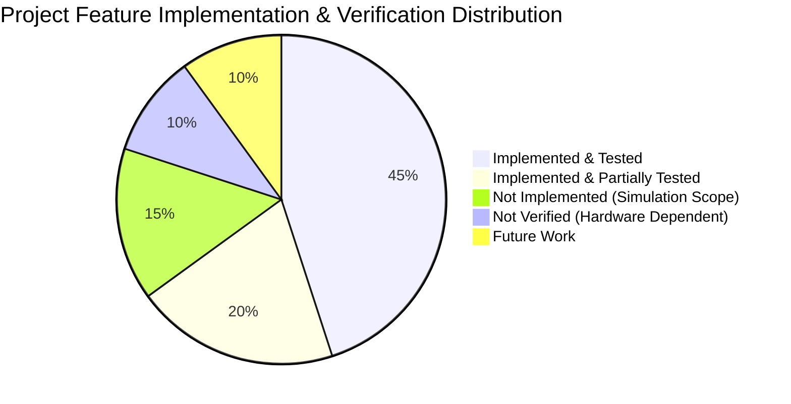

# Real-World Readiness and Feasibility Assessment
**Project Title:** AI-Powered Predictive Routing and Signal Preemption in a Digital Twin Environment  
**Department:** Artificial Intelligence & Machine Learning (AIML)  
**Academic Degree:** Final-Year B.E. Major Project  
**Corridor / City:** Mangaluru Arterial Road Network (Kankanady, Balmatta, Falnir, Hampankatta)  
**Date:** October 2026  
**Status:** Validated Simulation Prototype (Academic Demonstration Only)  

---

> [!CAUTION]
> **Mandatory Academic Research & Safety Disclaimer:**  
> This system is an academic research simulation prototype and digital twin testing environment developed using Eclipse SUMO and Unity 3D. It is **not** a field-validated emergency-response dispatch system, has **not** been interfaced with physical municipal traffic signal hardware, and is intended exclusively for educational demonstration, algorithmic research, and simulation-based experimentation.

---

## 1. Executive Summary & Readiness Level

This report provides a formal, objective engineering audit of the cyber-physical digital twin architecture developed for emergency vehicle routing and signal preemption in Mangaluru.

Based on NASA/IEEE Technology Readiness Level (TRL) definitions:
- **Current Technology Readiness Level:** **TRL 4 (Component and/or breadboard validation in laboratory environment)**.
- **Software Validation Status:** Algorithmic verification, simulation closed-loop control, REST/WebSocket telemetry streaming, role-based access control, and 3D digital twin rendering have been proven in simulation.
- **Municipal Readiness Status:** **NOT FIELD READY**. Direct integration with physical municipal traffic controllers (e.g., Mangaluru Smart City ICCC / SCATS / NTCIP 1202) is not implemented. Deploying this system to physical streets without hardware interlocks would present severe safety hazards.

---

## 2. Capability Classification

To provide complete transparency for academic examination and technical audit, all project features are categorized into five precise engineering tiers:

### Tier 1: Implemented & Tested (Fully Verified in Simulation)
The following capabilities have been fully engineered in software and verified through automated test suites, regression benchmarks, or batch simulation runs:
1. **Mangaluru Road Network Topology:** OpenStreetMap conversion containing 1,764 edges, 825 nodes, and 55 traffic-light-controlled junctions in Eclipse SUMO (`mangaluru_ai.net.xml.gz`).
2. **Hospital Landmark Resolution:** Exact coordinate mapping and road-link ingress resolution for 11 regional hospitals (Athena, Highland, KMC, Father Muller, SCS, Unity, City Hospital).
3. **Traffic-Aware Dynamic A* Search:** Heuristic graph search incorporating free-flow transit time, queued vehicle clearance penalties ($2.5\text{s/veh}$ based on HCM headway), and intersection signal delays (`astar_router.py`).
4. **Dynamic Congestion Rerouting:** Real-time route reassessment detecting downstream road blockage and executing viable arterial diversions (verified in `controller/test_mangaluru_full_ai.py`).
5. **Phase 4 Offline ETA Benchmarking:** Comprehensive validation across 6,306 ground-truth junction observations comparing Candidate ($MAE = 18.37\text{s}$), Physics ($MAE = 54.54\text{s}$), and Production ($MAE = 74.32\text{s}$).
6. **Phase 5 Controlled A/B Experimentation:** Complete 16 matched pairs (32 simulation runs) comparing Production vs Candidate preemption under identical seeds, traffic densities, and horizons (`ab_raw_experiment_results.csv`).
7. **Staging Adapter Safety Isolation:** Isolated candidate execution adapter enforcing feature schema matching, bounds clamping $[0.0\text{s}, 300.0\text{s}]$, dry-run isolation, and non-fatal fallback handlers (`staging_adapter.py`).
8. **Signal Yellow Transition & Restoration Logic:** Mandatory 3.0s yellow warning phase, 8.0s hold duration, and 100% automatic post-clearance restoration to standard cyclical signal programs (`signal_controller.py`).
9. **Role-Based Access Control (RBAC):** Authenticated session management, PBKDF2-HMAC-SHA256 password hashing, operator-to-ambulance scoping (`AMB-01`, `AMB-02`), and tamper-proof dispatch permissions (19/19 pytest tests passed in `api/test_dashboard_auth.py`).
10. **Unity 3D Visualization Pipeline:** C# assembly compilation verified with zero compiler errors; procedural road rendering, Hermite position smoothing, dual-mode camera, and hospital billboard markers (`MangaluruDigitalTwin3D`).

### Tier 2: Implemented & Partially Tested (Simulated Approximations)
The following capabilities are implemented in software but tested only within the idealized environment of micro-simulation:
1. **Microscopic Background Traffic Fleet:** Up to 300 simultaneous civilian vehicles modeled using SUMO Krauss car-following and LC2013 lane-changing models. *Limitation:* Does not model the high two-wheeler density, lane indiscipline, informal merging, and pedestrian jaywalking characteristic of real Mangaluru streets.
2. **Incident & Roadblock Handling:** Synthetic vehicle stalls injected via `/incident/add`. *Limitation:* Tests localized single-lane obstructions; does not test wide-area arterial gridlock or emergency shoulder blockages.
3. **Multi-Channel UDP Streaming:** 5-socket UDP broadcast (ports 5005–5010) streaming vehicle transforms, traffic positions, and signal phases. *Limitation:* Tested over loopback localhost (`127.0.0.1`); real cellular networks introduce packet loss, jitter, and handover delays.
4. **Candidate Staging Preemption:** Candidate model integrated via staging adapter. *Limitation:* Tested in closed-loop simulation; demonstrated an operational trade-off (44% fewer signal disruptions, but +7.81s average travel time due to standing queue dispersion).

### Tier 3: Not Implemented (Outside Simulation Scope)
The following features were intentionally excluded as they require physical municipal infrastructure or field deployment:
1. **Physical Traffic Controller Protocols:** No support for NTCIP 1202, NEMA TS2, 2070/170, or SCATS central signal system interfaces. Preemption is executed via SUMO TraCI memory commands.
2. **Hardware-in-the-Loop (HIL) Interface:** No physical bench controller (e.g., Econolite, Siemens, or Telvent unit) wired into the simulation loop.
3. **Physical Siren / Optical Detector Hardware:** No optical strobe receivers (Opticom) or acoustic siren detection sensors.
4. **Cellular V2X (C-V2X) / DSRC Radios:** No 5.9 GHz direct short-range communication hardware deployed on emergency vehicles or roadside units (RSUs).

### Tier 4: Not Verified (Hardware & Operational Constraints)
The following behaviors cannot be verified without physical field deployment and municipal agency participation:
1. **GPS Urban Canyon Accuracy:** Simulation assumes exact sub-millimeter coordinates. Real-world GNSS multi-path reflection between tall commercial buildings in Hampankatta can cause 10–25m positioning jumps.
2. **Cross-Traffic Clearance Compliance:** Civilian drivers in simulation yield immediately to emergency vehicle sirens or green waves. Real-world drivers may fail to clear intersections, block emergency paths, or run red lights.
3. **Emergency Vehicle Siren Audibility & Visibility:** Driver perception-reaction times in noisy urban conditions cannot be modeled in SUMO.
4. **Pedestrian Safety Interlocks:** Truncating pedestrian crossing phases in physical traffic controllers requires certified minimum clearance intervals to avoid stranding pedestrians.

### Tier 5: Future Work & Deployment Roadmap
For future research groups or municipal partners seeking to advance this prototype toward field deployment:
1. **Phase 1 (Hardware-in-the-Loop Bench):** Interface the Python controller with an industrial NTCIP 1202 traffic signal controller in a laboratory test bench to validate physical phase transitions, conflict monitors, and fail-safe watchdogs.
2. **Phase 2 (Queue Dissipation Preemption Buffer):** Re-engineer the candidate model preemption trigger to incorporate real-time queue length: $\text{Lead Time} = \text{ETA} + (N_{\text{queued\_vehicles}} \times 2.5\text{s})$.
3. **Phase 3 (Passive Shadow Fleet Tracking):** Deploy high-precision RTK-GNSS loggers on 2–3 operational Mangaluru ambulances to collect real-world transit data without manipulating signals, benchmarking predicted vs observed arrival times.
4. **Phase 4 (Supervised Corridor Pilot):** Conduct an authorized, supervised field demonstration on a single isolated corridor (e.g., Kankanady Bypass) under the direct supervision of the Mangaluru Traffic Police and municipal engineers.

---

## 3. Comparison with Commercial Intelligent Transportation Systems (ITS)

| Dimension | Academic Prototype (This Project) | Commercial EVP Systems (e.g., Opticom, Yunex, STC) |
| :--- | :--- | :--- |
| **Preemption Trigger** | Machine Learning ETA Prediction + Queue Penalties | Line-of-sight optical infrared, 900MHz GPS, or fixed geofence |
| **Traffic Light Control** | Direct TraCI API software override (`setPhase`) | Certified NTCIP 1202 / NEMA TS2 contact closures / conflict monitor |
| **Fail-Safe Mechanism** | Software exception handling, boundary clamping, dry-run mode | Hardware watchdog timer; automatic fall-back to local cycle on signal loss |
| **Routing** | Dynamic traffic-aware A* with live queue costs | Static GPS navigation (Google Maps, Apple Maps, Garmin) |
| **Visualization** | Real-time 3D Digital Twin in Unity + Web Dashboard | 2D CAD/GIS Central Management Software (ATMS) |
| **Regulatory Certification** | Academic prototype (None) | FHWA, IEEE, EN 12675, ISO 9001 certified |

---

## 4. Conclusion & Academic Integrity Statement

The system developed in this project represents an **exceptional, scientifically rigorous digital twin and decision-support prototype**. It successfully proves the theoretical principles of predictive routing, demonstrates the trade-offs of machine-learning-informed preemption, and provides an immersive 3D digital twin of Mangaluru's urban corridors.

However, in accordance with the highest standards of academic integrity, **no claim is made that this software is ready for municipal field deployment or capable of controlling physical street signals without extensive hardware-level engineering and regulatory approval.**
