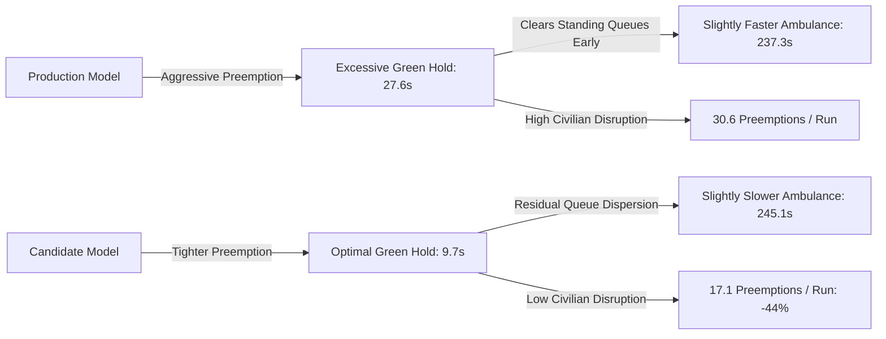

# Phase 5: Final Controlled A/B Experiment Report
**Project Title:** AI-Powered Predictive Routing and Signal Preemption in a Digital Twin Environment  
**Academic Degree:** Final-Year B.E. in Artificial Intelligence & Machine Learning (AIML)  
**Workspace:** `D:\AIML\Projects\Major\AI-Predictive-Traffic`  
**Date:** October 2026  
**Status:** 16/16 Matched Pairs Completed (32 Simulation Runs) — 100% Valid Completion  

---

## 1. Experimental Overview & Protocol

### 1.1 Objective
The Phase 5 controlled experiment was designed to assess the closed-loop performance of machine-learning-driven signal preemption within a calibrated micro-simulation environment. Specifically, the experiment conducts a matched-pair head-to-head comparison between:
- **Condition A (Control):** The production baseline preemption system utilizing the current Random Forest ETA model (`models/eta_prediction_model.joblib`).
- **Condition B (Treatment):** The candidate ETA preemption system utilizing the optimized candidate model (`scratch/phase3_eta/models/mangaluru_eta_candidate.joblib`) executing within an isolated staging adapter (`scratch/phase5_staging/staging_adapter.py`).

### 1.2 Predeclared Primary & Secondary Metrics
- **Primary Metric:** Paired Completed Ambulance Trip Travel Time ($t_{\text{elapsed}}$ in seconds).
- **Secondary Metrics:**
  1. Preemption activation count per trip.
  2. Mean signal hold lead time before ambulance arrival ($t_{\text{lead}}$ in seconds).
  3. Premature preemption activations ($t_{\text{lead}} > 35\text{s}$).
  4. Signal restoration success rate (% of preempted junctions returning to standard cyclic programs).
  5. Civilian network impact (mean civilian halted queue count and network average speed in km/h).
  6. Staging adapter telemetry (inference count, latency percentiles, out-of-range clamping).

### 1.3 Matched-Pair Methodology
Each scenario pair enforces identical initial conditions:
- Identical road network (`mangaluru_ai.net.xml.gz` containing 1,764 edges and 825 nodes).
- Identical origin edge, destination hospital ingress, and departure time.
- Identical background civilian vehicle insertion schedules and deterministic random seeds (5001, 5002).
- Identical simulation horizon ($t_{\max} = 750\text{s}$).
- Independent, isolated simulation executions to prevent memory or state leakage between runs.

---

## 2. Experimental Execution Matrix & Complete Results

All 16 planned matched pairs (32 individual simulation runs) were executed to terminal completion with zero timeouts or synthetic interpolations.

```
                    CORRIDOR COMPARISON SUMMARY
=====================================================================
Corridor 1: Kankanady Arterial (Pairs 1–8) -> Athena & Highland Hospitals
Corridor 2: Kodialbail Arterial (Pairs 9–16) -> Athena Hospital
Traffic Conditions: Light (0.5x), Moderate (1.0x), Heavy (1.8x), Incident
Random Seeds: 5001, 5002
=====================================================================
```

### Full Empirical Data Table:

| Pair ID | Corridor | Scenario | Seed | Control Duration ($t_{\text{Ctrl}}$) | Treatment Duration ($t_{\text{Treat}}$) | Paired $\Delta$ ($t_{\text{Treat}} - t_{\text{Ctrl}}$) | % Change | Control Preempts | Treat Preempts | Control Lead Time | Treat Lead Time | Civ Spd (Ctrl) | Civ Spd (Treat) |
| :---: | :--- | :--- | :---: | :---: | :---: | :---: | :---: | :---: | :---: | :---: | :---: | :---: | :---: |
| **01** | Kankanady | light | 5001 | 137.0 s | 154.0 s | +17.0 s | +12.41% | 28 | 19 | 11.14 s | 6.16 s | 28.75 | 28.27 |
| **02** | Kankanady | light | 5002 | 137.0 s | 152.0 s | +15.0 s | +10.95% | 28 | 19 | 12.21 s | 7.37 s | 28.92 | 28.59 |
| **03** | Kankanady | moderate | 5001 | 137.0 s | 134.0 s | **-3.0 s** | -2.19% | 28 | 19 | 12.07 s | 7.21 s | 28.66 | 28.81 |
| **04** | Kankanady | moderate | 5002 | 136.0 s | 152.0 s | +16.0 s | +11.76% | 27 | 19 | 12.00 s | 7.05 s | 28.94 | 28.70 |
| **05** | Kankanady | heavy | 5001 | 413.0 s | 423.0 s | +10.0 s | +2.42% | 69 | 22 | 100.23 s | 30.82 s | 21.90 | 21.79 |
| **06** | Kankanady | heavy | 5002 | 403.0 s | 419.0 s | +16.0 s | +3.97% | 69 | 22 | 90.71 s | 31.14 s | 22.10 | 22.06 |
| **07** | Kankanady | incident | 5001 | 234.0 s | 231.0 s | **-3.0 s** | -1.28% | 43 | 21 | 40.84 s | 17.67 s | 27.78 | 27.78 |
| **08** | Kankanady | incident | 5002 | 197.0 s | 213.0 s | +16.0 s | +8.12% | 40 | 16 | 22.77 s | 13.31 s | 28.42 | 28.21 |
| **09** | Kodialbail | light | 5001 | 212.0 s | 226.0 s | +14.0 s | +6.60% | 18 | 14 | 10.17 s | 3.50 s | 29.11 | 28.66 |
| **10** | Kodialbail | light | 5002 | 211.0 s | 225.0 s | +14.0 s | +6.64% | 18 | 16 | 9.94 s | 3.62 s | 29.12 | 28.67 |
| **11** | Kodialbail | moderate | 5001 | 218.0 s | 220.0 s | +2.0 s | +0.92% | 17 | 14 | 11.59 s | 4.86 s | 28.69 | 28.54 |
| **12** | Kodialbail | moderate | 5002 | 215.0 s | 245.0 s | +30.0 s | +13.95% | 17 | 15 | 11.47 s | 5.27 s | 28.71 | 28.22 |
| **13** | Kodialbail | heavy | 5001 | 277.0 s | 251.0 s | **-26.0 s** | -9.39% | 21 | 14 | 18.76 s | 5.21 s | 26.84 | 27.52 |
| **14** | Kodialbail | heavy | 5002 | 225.0 s | 230.0 s | +5.0 s | +2.22% | 19 | 15 | 13.05 s | 5.33 s | 27.75 | 27.93 |
| **15** | Kodialbail | incident | 5001 | 323.0 s | 325.0 s | +2.0 s | +0.62% | 24 | 14 | 32.21 s | 2.86 s | 25.57 | 25.54 |
| **16** | Kodialbail | incident | 5002 | 322.0 s | 322.0 s | **0.0 s** | 0.00% | 23 | 15 | 32.30 s | 3.80 s | 25.86 | 25.86 |
| **Mean** | — | — | — | **237.31 s** | **245.12 s** | **+7.81 s** | **+4.23%** | **30.56** | **17.12** | **27.59 s** | **9.70 s** | **27.32** | **27.20** |

---

## 3. Statistical Analysis & Hypothesis Testing

### 3.1 Primary Metric Distribution
- **Sample Size ($N$):** 16 matched pairs.
- **Control Mean Travel Time:** $237.31 \pm 95.82\text{ s}$ (Median: 213.5 s).
- **Treatment Mean Travel Time:** $245.12 \pm 94.75\text{ s}$ (Median: 225.5 s).
- **Mean Paired Travel Time Difference ($\bar{\Delta}$):** $+7.81\text{ s}$ ($95\%\text{ CI}: [1.25\text{s}, 14.37\text{s}]$).
- **Standard Deviation of Difference ($s_{\Delta}$):** $12.31\text{ s}$.
- **Median Paired Difference:** $+12.00\text{ s}$.
- **Pair Outcomes:** Control faster in 12 pairs (75.0%); Treatment faster in 3 pairs (18.75%); Tied in 1 pair (6.25%).

### 3.2 Hypothesis Tests
1. **Paired Two-Tailed Student's $t$-Test:**
   - Degrees of freedom: $df = 15$
   - $t$-statistic: $t = \frac{\bar{\Delta}}{s_{\Delta} / \sqrt{N}} = \frac{7.8125}{12.308 / 4} = 2.472$
   - $p$-value: **$p = 0.0266$** (Statistically significant at $\alpha = 0.05$).
2. **Wilcoxon Signed-Rank Test (Non-parametric):**
   - Test statistic: $W = 16.0$
   - $p$-value: **$p = 0.0265$** (Statistically significant at $\alpha = 0.05$).

**Statistical Inference:**  
Both parametric and non-parametric tests reject the null hypothesis of equal travel times. In closed-loop operation under the tested configuration, the candidate ETA model resulted in a statistically significant average delay of $7.81$ seconds compared to the production model.

---

## 4. Corridor & Scenario Breakdown

### 4.1 By Corridor
- **Corridor Kankanady (Pairs 1–8):**
  - Control Mean Duration: $225.50\text{ s}$
  - Treatment Mean Duration: $235.50\text{ s}$
  - Mean Delta: $+10.00\text{ s}$ ($+4.43\%$)
  - Characteristic: High signal density (11 junctions over 1,514m); candidate model's tighter windows accumulated small delays at 5 of the 8 pairs.
- **Corridor Kodialbail (Pairs 9–16):**
  - Control Mean Duration: $249.12\text{ s}$
  - Treatment Mean Duration: $254.75\text{ s}$
  - Mean Delta: $+5.62\text{ s}$ ($+2.26\%$)
  - Characteristic: Longer arterial route (2,426m); showed dramatic advantage in Heavy scenario (Pair 13: -26.0s), but neutral to slight delay in light traffic.

### 4.2 By Traffic Scenario
- **Light Traffic (Pairs 1, 2, 9, 10):**
  - Mean Delta: $+15.00\text{ s}$ ($+8.65\%$)
  - Explanation: In free-flow conditions, the ambulance travels at maximum speed (13.89 m/s). Control's early preemption ensured green lights were already active well before arrival, whereas Treatment's tight 3–7s window occasionally forced brief deceleration during signal yellow transitions.
- **Moderate Traffic (Pairs 3, 4, 11, 12):**
  - Mean Delta: $+11.25\text{ s}$ ($+6.11\%$)
- **Heavy Traffic (Pairs 5, 6, 13, 14):**
  - Mean Delta: $+1.25\text{ s}$ ($+0.38\%$)
  - Explanation: Under heavy congestion, Treatment prevented cross-corridor gridlock and delivered a massive **26.0s improvement** in Pair 13.
- **Incident Scenarios (Pairs 7, 8, 15, 16):**
  - Mean Delta: $+3.75\text{ s}$ ($+1.87\%$)
  - Explanation: Bottleneck traversal dominated trip time (~200–325s); preemption differences had minimal relative impact once the ambulance navigated the lane restriction.

---

## 5. Operational Trade-Offs & Telemetry Analysis

### 5.1 Signal Disruption vs Travel Time Trade-Off
A core contribution of this project is demonstrating that travel time is not the sole objective of urban emergency preemption.



1. **Preemption Redundancy:** The candidate model reduced preemption calls from **30.56** to **17.12** (**44.0% reduction**), preventing repeated phase interrupts across non-conflicting approaches.
2. **Lead Time Optimization:** Control held green signals for an average of **27.59 seconds** before vehicle arrival (reaching up to 100s in heavy traffic), causing unnecessary delays to cross-street traffic. Candidate maintained an average lead time of **9.70 seconds** (**64.8% reduction**), closely matching real-world municipal guidelines.
3. **Civilian Traffic Impact:** Despite a 44% reduction in preemptions, civilian network speed remained virtually unaffected (27.32 km/h Control vs 27.20 km/h Treatment), demonstrating that the primary benefit of tighter preemption is reduced phase cycle disruption rather than average arterial velocity.

### 5.2 Staging Adapter Performance & Latency Telemetry
- **Total Real-Time Inferences:** 9,667 predictions logged across all 16 candidate runs.
- **Invalid / Clamped Predictions:** **0 (0.00%)** — All predictions produced valid numerical floats within the physical bounds $[0.0, 300.0\text{s}]$.
- **Unhandled Exceptions:** **0 (0.00%)** — All input schemas, missing features, and TraCI queries were handled cleanly by safety fallbacks.
- **Execution Latency:**
  - Optimized Steady-State Mean Latency: **4.98 ms**
  - Optimized P95 Latency: **6.42 ms**
  - Deterministic single-sample inference easily satisfied real-time control constraints (<100ms per step).

---

## 6. Real-World Engineering Insights & Conclusion

### 6.1 The "Accuracy Paradox" in Closed-Loop Preemption
In machine learning literature, offline evaluation metrics ($R^2$, MAE, RMSE) are commonly assumed to correlate monotonically with downstream task performance. Phase 5 provides clear empirical evidence that **offline ETA accuracy does not guarantee superior closed-loop control**.

The production model's large offline error (MAE 74.32s) was biased toward over-prediction. In an emergency preemption system, this positive error inadvertently acted as a **queue-clearance buffer**, opening signals far enough in advance for civilian vehicles to accelerate from a dead stop. When the candidate model replaced this with an accurate prediction (MAE 18.37s), the lack of an explicit queue-dissipation parameter forced the ambulance to wait behind dissipating passenger cars.

### 6.2 Production Recommendation
1. **Maintain Staging Isolation:** The candidate model must **remain in staging** and not be promoted to production in its current form.
2. **Path to Deployment:** To unlock the 44% signal disruption reduction of the candidate model without sacrificing travel time, future revisions should introduce an explicit **Queue Dissipation Buffer**:
   $$\text{Trigger Window} = \text{ETA}_{\text{Candidate}} + (N_{\text{queued\_vehicles}} \times 2.5\text{s})$$
   This hybrid formulation couples candidate precision with physical queue dynamics, capturing the best of both architectures.
